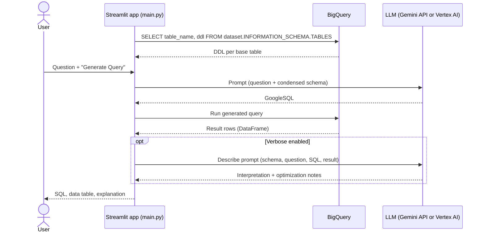

# Gemini BigQuery

A Streamlit app that turns a natural-language question into a GoogleSQL query with Gemini, runs it on BigQuery, and
explains the result.

[Demo recording (wynnsights.webm)](wynnsights.webm)

## Description

You pick a BigQuery dataset and type a question in plain English. The app reads the DDL of every base table in the
dataset from `INFORMATION_SCHEMA.TABLES` and gives that schema to an LLM as context. It shows the GoogleSQL the LLM
writes, runs it on BigQuery, and displays the result as a table. With *Verbose* on, a second LLM call describes what
the query does, what the data is useful for, and how well the SQL is optimized.

It is a small proof of concept (one Python file) for analysts and engineers who want to try text-to-SQL on their own
BigQuery datasets.

## Features

- **Schema-grounded prompts:** table DDL is loaded with LangChain's `BigQueryLoader` and condensed to table and
  column lists.
- **Model choice:** `gemini-pro` through the Gemini API (`langchain-google-genai`), or `codechat-bison` through
  Vertex AI (`langchain-google-vertexai`).
- **Tunable generation:** sidebar controls for max output tokens, temperature, top-p, and top-k.
- **Runs the query:** the generated SQL is run with the BigQuery client (5-minute timeout, exponential retry) and
  shown as a DataFrame.
- **Explains the result:** an optional second chain interprets the question, the SQL, and the returned data.
- **Schema browser:** an expandable panel shows the dataset schema as a `{table: {column: type}}` dictionary.
- **Container image:** a `Dockerfile` (Python 3.11 slim, non-root user, port 8501) and a `cloudbuild.yaml` that builds
  it and pushes it to Artifact Registry.

## Architecture



## Requirements

- Python 3.11 (the version in the `Dockerfile`).
- A Google Cloud project with BigQuery enabled. Application Default Credentials need permission to read dataset
  metadata and run query jobs.
- A Gemini API key for `gemini-pro`. Vertex AI enabled in the project for `codechat-bison`.

## Installation and quick start

```bash
git clone https://github.com/Lapeyus/Gemini-BigQuery.git
cd Gemini-BigQuery
python3.11 -m venv .venv && source .venv/bin/activate
pip install -r requirements.txt
pip install langchain-google-vertexai   # imported by main.py but missing from requirements.txt

gcloud auth application-default login
cat > .env <<'EOF'                       # .env is ignored by .gitignore
PROJECT_ID=<your-project-id>
REGION=<your-region>
GOOGLE_API_KEY=<your-gemini-api-key>
EOF

streamlit run main.py
```

Open <http://localhost:8501>.

With Docker (after adding `langchain-google-vertexai` to `requirements.txt`):

```bash
docker build -t gemini-bigquery .
docker run -p 8501:8501 --env-file .env gemini-bigquery
```

The container also needs Google Cloud credentials. Run it on a GCP runtime with an attached service account, or mount
a credentials file and set `GOOGLE_APPLICATION_CREDENTIALS`. The container path was not tested during this
documentation pass.

## Usage

1. In the sidebar, pick a dataset: `<PROJECT_ID>.thelook` (a copy of the public *theLook eCommerce* dataset in your
   project) or `bigquery-public-data.github_repos`.
2. Choose the model and generation settings.
3. Type a question, for example *"Top 10 products by revenue last month"*, and click **Generate Query**.
4. Review the SQL on the left and the data on the right. If *Verbose* is on, an explanation appears under the SQL.

## Repository layout

```text
.
├── main.py              # Streamlit app: schema loading, prompts, LLM chains, BigQuery execution
├── requirements.txt     # pinned dependencies (Streamlit 1.30, LangChain 0.1, BigQuery 3.12)
├── Dockerfile           # Python 3.11-slim image, non-root, exposes 8501
├── cloudbuild.yaml      # builds and pushes the image to Artifact Registry
├── wynnsights.webm      # demo recording
├── .github/ISSUE_TEMPLATE/
│   └── genai-request-a-code-change-or-upgrade.md  # JSON change-request template (see genai-issue-actor)
└── LICENSE              # MIT
```

## Configuration

| Variable | Used for |
|----------|----------|
| `PROJECT_ID` | Builds the `<PROJECT_ID>.thelook` dataset option |
| `REGION` | Read from the environment but not used by the code |
| `GOOGLE_API_KEY` | Gemini API key for `gemini-pro` |

Values load from a local `.env` file through `python-dotenv`. `.env`, `venv/`, and Terraform state or `*.tfvars` are
in `.gitignore`. The image tag in `cloudbuild.yaml` is hard-coded to a specific project and repository. Change it to
your own Artifact Registry path.

## Tests

There are no automated tests.

## Deployment

`gcloud builds submit` builds the image with `cloudbuild.yaml` and pushes it to Artifact Registry. The repo does not
include the runtime target (for example, a Cloud Run service definition).

## Status and known limitations

- **Status:** proof of concept, inactive. The commits are from 2024-01-17 to 2024-02-05.
- `langchain_google_vertexai` is imported but not listed in `requirements.txt`, so a clean install fails on import.
- The generated SQL runs **as-is**, with no read-only check and no dry-run cost estimate. Run the app with an identity
  that can only read the target datasets, and set a maximum-bytes-billed quota.
- The schema is fetched once per Streamlit rerun, and the DDL is parsed with regular expressions. Nested or `STRUCT`
  columns, and DDL without an `OPTIONS` clause, may parse poorly.
- The *Top P* and *Top K* sliders only allow 0 or 1.
- `gemini-pro` and `codechat-bison` are early-2024 model names and may no longer be available.
- The dataset options are hard-coded in `main.py`.

## License

MIT. See [LICENSE](LICENSE).
